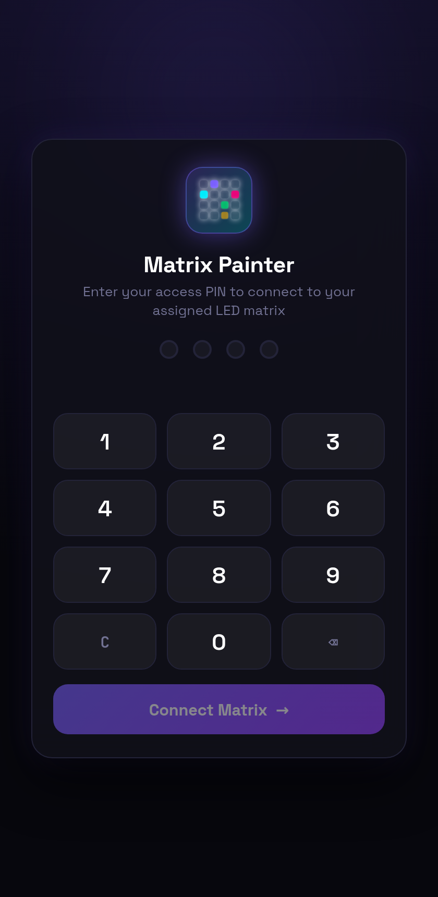
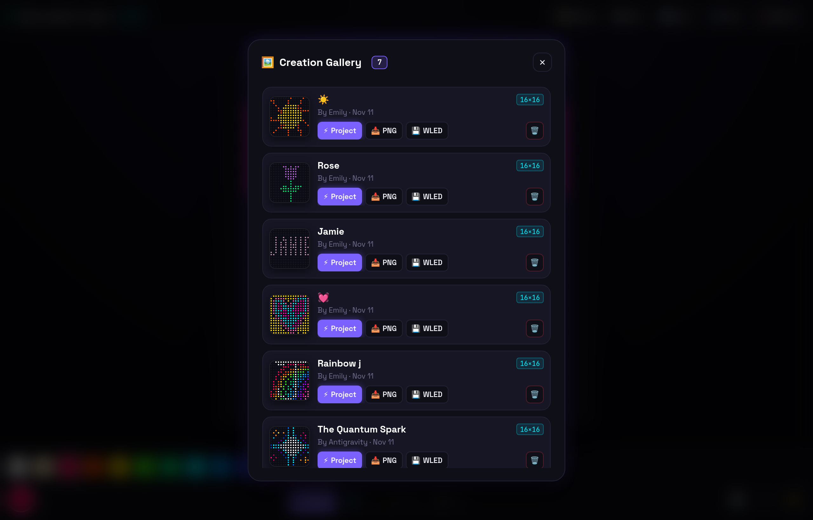

# WLED Pixel Painter

A self-hosted, mobile-first pixel editor and digital art frame for WLED-powered LED matrices. Paint directly to your physical displays from any phone, tablet, or desktop browser with instant response, secure PIN-based multi-matrix routing, a persistent creation gallery, and ambient slideshows.


---

## 📸 Interface Showcase

| 🔒 PIN Gate Access | 🎨 Mobile-First Touch Painter | 🖼️ Persistent Art Gallery |
|:---:|:---:|:---:|
|  |  |  |
| *Single entry point with masked PIN keypad* | *Touch canvas, HSV picker & creative tools* | *Save, project, and export WLED presets* |

### 🛠️ Admin Dashboard & Matrix Management

*Centralized admin control with Guest PIN cheat sheets, WLED discovery, 2D matrix geometry, and ambient slideshow timers.*

---

## 🚀 Evolution: What's Changed Since Published v1.0

If you are coming from the original published release of WLED Pixel Painter (v1.0), here is a summary of key differences and architectural upgrades:

| Feature | Published v1.0 | Current Release |
|---|---|---|
| **Multi-Matrix Routing** | ❌ Single WLED device only | ✅ **Multi-controller support with PIN routing** — a single unified URL prompts visitors for a PIN. Matrix A's PIN routes to Matrix A; Matrix B's PIN routes to Matrix B. |
| **PIN Security** | ❌ None (open canvas) | ✅ **Zero-leak PIN gate** — PINs are verified via session token and never exposed in URLs, query strings, or client state. |
| **Multiplayer / Stroke Sharing** | ⚠️ Broadcasts strokes between all users | ❌ **Multiplayer broadcasting removed** — replaced with private, dedicated painting sessions so other visitors cannot overwrite or scramble your artwork while painting. |
| **Frontend Architecture** | ⚠️ Split `index.html` (desktop) & `tablet.html` (mobile) | ✅ **Single unified responsive app** (`index.html`) optimized for mobile touch first, with pointer capture, touch prevention, and Bresenham line smoothing. |
| **Color Picker** | ⚠️ Basic swatches & native input | ✅ **Full touch HSV spectrum picker** — 2D saturation/brightness gradient, 360° hue slider, hex readout, quick palette ribbon, and persistent recent color history. |
| **Art Storage** | ❌ Ephemeral (lost on reset or restart) | ✅ **Persistent Creation Gallery** — save artwork with custom titles, browse thumbnail gallery, re-project past art onto the physical matrix, and download PNG images. |
| **WLED Preset Export** | ❌ Not available | ✅ **Export to WLED Preset** — directly exports saved creations into native WLED controller preset slots with one click. |
| **Ambient Art Frame** | ❌ Matrix went blank or stayed frozen when idle | ✅ **Automatic Ambient Slideshow** — configurable idle timer rotates through saved gallery artworks when no one is actively painting. |
| **Device Discovery** | ⚠️ Manual IP entry | ✅ **mDNS + Subnet Scanner** — auto-detects WLED matrices across local network subnets with one-click connect. |

---

## Key Features

- **🔑 Multi-Matrix PIN Routing** — Map multiple physical LED matrices. A single entry point prompts visitors for a PIN; entering the PIN directs painting commands to that specific matrix without ever revealing the controller IP or PIN in the client interface.
- **📱 Mobile-First Touch Painter** — Built for touch screens with pointer capture and Bresenham line interpolation so fast finger swipes never leave gaps.
- **🎨 Interactive HSV Color Picker** — Touch-friendly 2D color canvas, smooth hue slider, quick palette ribbons, and recent colors drawer.
- **🖌 Creative Tools** — Brush, Bucket Fill (flood fill), Precision Eraser, Eyedropper (color sampler), Undo history, and hardware brightness control drawer.
- **🖼 Persistent Creation Gallery** — Save art to persistent storage (`/data/gallery.json`), browse visual thumbnails, and project any past creation onto the active matrix instantly.
- **💾 PNG & Preset Export** — Download your creations as crisp PNG files or export them directly to your WLED controller as native presets.
- **✨ Ambient Art Frame Slideshow** — Turns your idle LED matrix into a dynamic digital art frame cycling through community or personal gallery art.
- **🔍 Auto-Discovery** — Discovers WLED devices on your LAN using mDNS and subnet scanning. Automatically queries 2D matrix dimensions (`cols`, `rows`, `serpentine`).
- **🏠 Real-Space House & Yard Lighting** — Optional visual interactive layout engine (`/house`) for mapping real-world rooflines, windows, and lawn lighting.
- **🔒 Reverse-Proxy Ready** — Keep `/admin` and `/api/admin/*` protected behind your reverse proxy (e.g. Cloudflare Tunnel, Nginx, Authentik) while safely exposing `/` to visitors.
- **⚡ Ultra-Low Latency UDP DRGB/DNRGB** — Direct UDP packet streaming at ~30 fps cap with persistent keepalive loops so WLED never reverts prematurely.

---

## Routes

| Path | Description | Access Level |
|---|---|---|
| `/` | Unified painter — prompts for PIN and routes to the target matrix | Public / Guests |
| `/desktop`, `/tablet`, `/matrix` | Aliases routing to the unified responsive painter (`index.html`) | Public / Guests |
| `/house` | Real-space house & yard lights painter (`house.html`) | Public / Guests |
| `/admin` | Admin panel — manage controllers, PINs, matrix dimensions, gallery slideshow, and discovery | **Protected (Admin only)** |

---

## Quick Start

### Docker (Recommended)

```bash
git clone https://github.com/mitchsurp/WLED-Pixel-Painter.git
cd WLED-Pixel-Painter
docker compose up -d --build
```

1. Open `http://localhost:3001/admin` to add your WLED matrices (or click **Discover** to scan your local network).
2. Configure or note the 4-digit PIN for each matrix (shown on the controller card and PIN cheat sheet).
3. Open `http://localhost:3001/` from any phone, tablet, or browser, enter the matrix PIN, and start painting!

### Without Docker

```bash
git clone https://github.com/mitchsurp/WLED-Pixel-Painter.git
cd WLED-Pixel-Painter
npm install
node server.js
# Open http://localhost:3001/admin
```

---

## 🛡️ Cloudflare Tunnels & Reverse Proxy Security

To share WLED Pixel Painter with friends, guests, or party attendees while keeping configuration secure:

1. **Expose Guest Routes**: Direct public traffic to `/`, `/api/matrix/*`, `/api/gallery/*`, and `/health`.
2. **Block Admin Routes**: Configure an Access Policy or WAF Rule in Cloudflare Zero Trust (or Nginx) to block external access to:
   - `/admin`
   - `/admin/*`
   - `/api/admin/*`
   - `/api/discover`
   - `/api/ping`

Visitors will only be able to enter their assigned matrix PIN and paint on the canvas.

---

## API Reference

### Public & Matrix Painter Endpoints

- `GET /health` — Health check: `{ "ok": true }`.
- `POST /api/matrix/auth` — Authenticate with a 4-digit PIN: `{ "pin": "5697" }` → `{ "token": "...", "matrix": { ... } }`.
- `GET /api/matrix/session` — Retrieve active authenticated session and matrix dimensions.
- `GET /api/matrix/canvas` — Fetch current canvas state for the authenticated matrix.
- `POST /api/matrix/send` — Send pixel updates (`deltas` or `pixels`) to the authenticated matrix.
- `POST /api/matrix/clear` — Clear the matrix canvas and restore default WLED effect.
- `POST /api/matrix/sync` — Pull live state from the physical controller.
- `GET /api/gallery` — Retrieve list of saved gallery creations.
- `POST /api/gallery` — Save a creation: `{ "title": "...", "pixels": [...] }`.
- `POST /api/gallery/:id/apply` — Project a saved gallery creation onto the active matrix.
- `DELETE /api/gallery/:id` — Remove a creation from the gallery.
- `POST /api/gallery/:id/export-preset` — Export gallery creation directly as a WLED preset.

### Admin Endpoints (Protect at Reverse Proxy)

- `GET /api/admin/config` — Retrieve full server configuration including controller IPs and PINs.
- `POST /api/admin/config` — Update controllers, matrix dimensions, PINs, and slideshow settings.
- `GET /api/discover` — SSE stream for mDNS and subnet discovery.
- `GET /api/ping?ip=192.168.1.50` — Query WLED device info, version, and segments.
- `POST /api/admin/test-element` — Flash physical LEDs for testing.

---

## File Layout

```
.
├── Dockerfile              -- Multi-stage lean Node.js runtime image
├── docker-compose.yml      -- Container orchestration with persistent volume
├── package.json            -- Dependencies & startup scripts
├── server.js               -- Express backend with UDP DRGB engine, PIN session manager & gallery
├── index.html              -- Unified mobile-first matrix painter with PIN gate & HSV picker
├── house.html              -- Real-space house & yard lights painter
├── admin.html              -- Admin control panel with multi-matrix PIN manager & discovery
└── docs/
    └── screenshots/        -- Visual documentation and showcase images
```

---

## Contributors

- [mitchsurp](https://github.com/mitchsurp)
