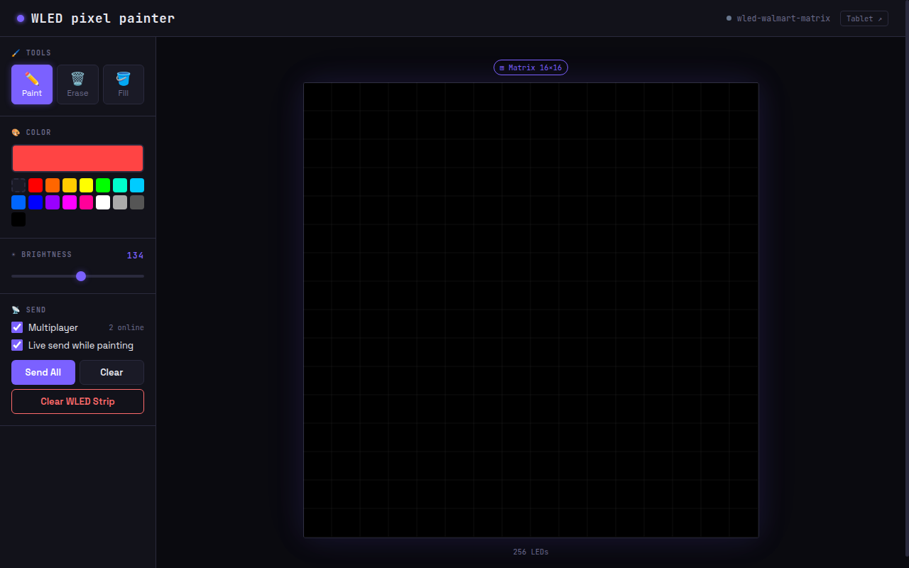
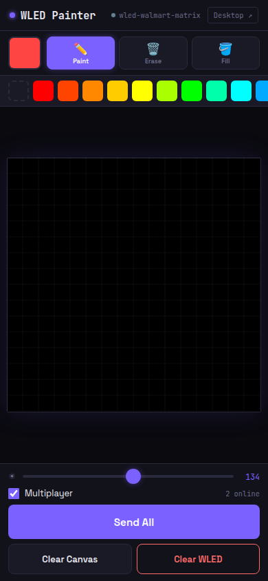
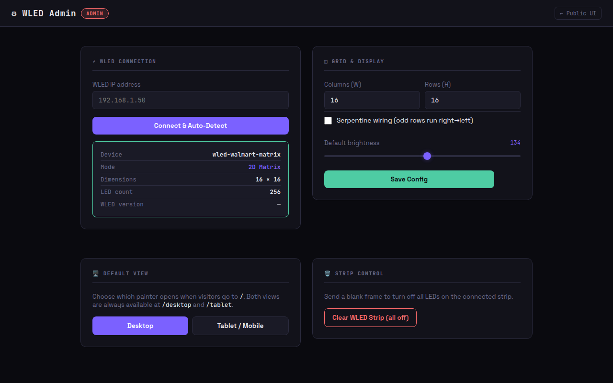

# WLED Pixel Painter

A self-hosted, browser-based pixel editor for WLED-powered LED matrices and strips. Paint directly to your LEDs in real time, alone or with others simultaneously.

---

## Screenshots

**Desktop painter**


**Tablet / mobile painter**


**Admin panel**


---

## Features

- **Real-time painting** — pixels hit your LEDs as you draw, with a ~30 fps debounced flush via UDP DRGB protocol
- **Multiplayer** — multiple painters on different devices share a live canvas; only changed pixels are sent as deltas, keeping traffic minimal
- **Desktop and tablet/mobile interfaces** — full-featured sidebar layout for desktop, touch-optimized full-viewport layout for phones and tablets
- **Auto-detection** — enter your WLED IP and the app reads device name, LED count, and 2D matrix dimensions automatically
- **Persistent keepalive** — the server re-sends the canvas every 60 seconds so WLED never reverts to its default effect while the server is running
- **Server-side config** — WLED IP and all settings are stored on the server, not in the browser, so every client gets the same layout without any setup
- **Admin panel** — configure WLED connection, grid dimensions, serpentine wiring, brightness, and default view at `/admin`
- **HomeAssistant-friendly** — `POST /api/clear` returns WLED to its normal effects and stops the keepalive; schedule it from any automation system
- **Lightweight** — two npm dependencies (Express, cors), one Docker image, no database

> **Note:** Version 1.0 supports one WLED device per installation. Multi-device support is planned for a future release.

---

## Quick start

### Docker (recommended)

```bash
git clone https://github.com/mitchsurp/WLED-Pixel-Painter.git
cd WLED-Pixel-Painter
docker compose up -d
```

Open `http://localhost:3001/admin`, enter your WLED IP, and click **Connect & Auto-Detect**.

Pull the pre-built image instead of building locally:

```bash
docker pull ghcr.io/mitchsurp/wled-pixel-painter:latest
```

Or with a pinned version:

```bash
docker pull ghcr.io/mitchsurp/wled-pixel-painter:1.0
```

### Without Docker

```bash
npm install
node server.js
# open http://localhost:3001
```

---

## Networking

### Linux
`docker-compose.yml` uses `network_mode: host` so the container can reach WLED on your LAN directly. No extra configuration needed.

### macOS / Windows
Docker Desktop runs containers in a VM where `network_mode: host` has no effect. Remove that line from `docker-compose.yml` — Docker Desktop routes LAN traffic automatically and your WLED IP will be reachable normally.

---

## Routes

| Path | Description |
|---|---|
| `/` | Painter — desktop or tablet view depending on admin setting |
| `/desktop` | Always the desktop painter |
| `/tablet` | Always the tablet/mobile painter |
| `/admin` | Admin panel — configure WLED and grid settings |

---

## API

All endpoints are JSON over HTTP. The WLED IP is stored server-side; clients never need to supply it.

### `GET /health`
Returns `{ "ok": true }`. Useful for uptime monitors and container health checks.

### `GET /api/config`
Returns the current configuration, excluding the WLED IP (kept server-side).

```json
{
  "ok": true,
  "config": {
    "brightness": 128,
    "cols": 16,
    "rows": 16,
    "serpentine": false,
    "isMatrix": true,
    "deviceName": "my-matrix",
    "ledCount": 256,
    "udpPort": 21329,
    "defaultMode": "desktop"
  }
}
```

### `POST /api/config`
Save configuration. Accepts any subset of config fields. Block this endpoint at your reverse proxy to restrict changes to the admin panel.

```json
{ "brightness": 200, "defaultMode": "tablet" }
```

### `GET /api/ping?wledIp=192.168.1.50`
Connects to a WLED device, reads its info, auto-detects 2D matrix dimensions, saves the result, and returns detection details.

```json
{
  "ok": true,
  "detected": { "isMatrix": true, "cols": 16, "rows": 16, "ledCount": 256 }
}
```

### `GET /api/canvas`
Returns the full current canvas state as a flat LED-indexed array of `[r, g, b]` triples, plus connected user count.

```json
{ "ok": true, "canvas": [[255,0,0],[0,255,0],...], "users": 3 }
```

### `GET /api/events`
Server-Sent Events stream. Connect to receive real-time canvas updates. Three event types:

| Event | Data | When |
|---|---|---|
| `canvas` | `[[r,g,b], ...]` — full 256-entry array | On connect (bootstrap) and after clear |
| `delta` | `[[ledIdx,r,g,b], ...]` — changed pixels only | When any painter sends new pixels |
| `users` | `3` — integer count | When a client connects or disconnects |

Example (browser):
```js
const es = new EventSource('/api/events');
es.addEventListener('delta', e => {
  const changes = JSON.parse(e.data); // [[ledIdx,r,g,b], ...]
});
```

### `POST /api/send`
Push pixels to the canvas and WLED. Accepts two shapes:

**Full canvas** (single-player / overwrite):
```json
{ "pixels": [[255,0,0],[0,255,0],...], "brightness": 128 }
```
`pixels` is a flat LED-indexed array of `[r, g, b]` values, one per LED (length must match `ledCount`).

**Delta** (multiplayer / merge):
```json
{ "delta": [[0,255,0,0],[5,0,255,0]], "brightness": 128 }
```
`delta` is an array of `[ledIndex, r, g, b]` tuples. Only the specified LEDs are updated; others keep their current color.

Both shapes:
- Merge changes into the server's shared canvas state
- Broadcast the delta to all connected SSE clients
- Schedule a debounced UDP flush to WLED (~30 fps cap)
- Accept an optional `brightness` field; if it differs from the saved value, WLED brightness is updated immediately

Returns `{ "ok": true }`.

### `POST /api/clear`
Resets the server canvas to all black, broadcasts a `canvas` event to all connected painters (clearing their grids), and sends a blank UDP frame to WLED with a 1-second timeout so WLED returns to its normal effect immediately after.

The keepalive will not re-send while the canvas remains blank, so WLED stays in its default mode until someone paints again.

Returns `{ "ok": true }`.

Example HomeAssistant `rest_command`:
```yaml
rest_command:
  clear_wled_painter:
    url: http://192.168.1.205:3001/api/clear
    method: POST
```

---

## Docker Compose reference

```yaml
services:
  wled-painter:
    image: ghcr.io/mitchsurp/wled-pixel-painter:latest
    container_name: wled-painter
    restart: unless-stopped
    network_mode: host        # Linux only — gives LAN access to reach WLED
    volumes:
      - wled-config:/data     # persists config.json across restarts
    environment:
      - PORT=3001
      - CONFIG_PATH=/data/config.json

volumes:
  wled-config:
```

---

## File layout

```
.
├── Dockerfile
├── docker-compose.yml
├── package.json
├── server.js          -- Express API server
├── index.html         -- Desktop painter
├── tablet.html        -- Tablet / mobile painter
├── admin.html         -- Admin panel
└── docs/
    └── screenshots/
```

---

## Contributors

- [mitchsurp](https://github.com/mitchsurp)
- [Claude](https://claude.ai) (Anthropic) — AI pair programmer
